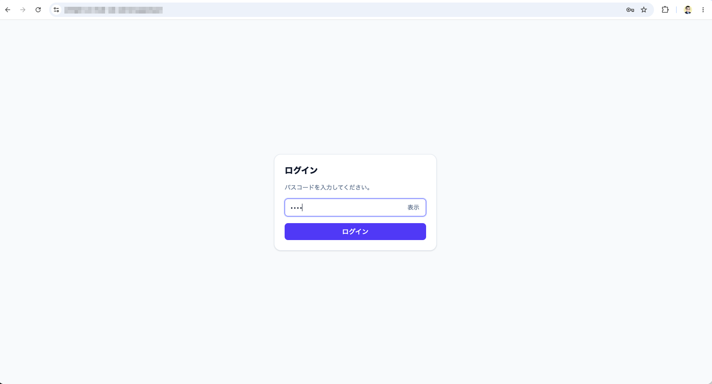
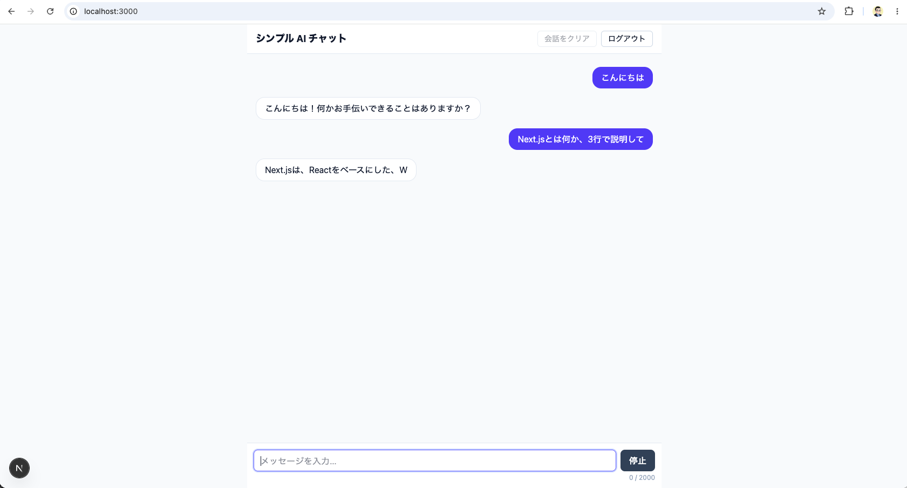
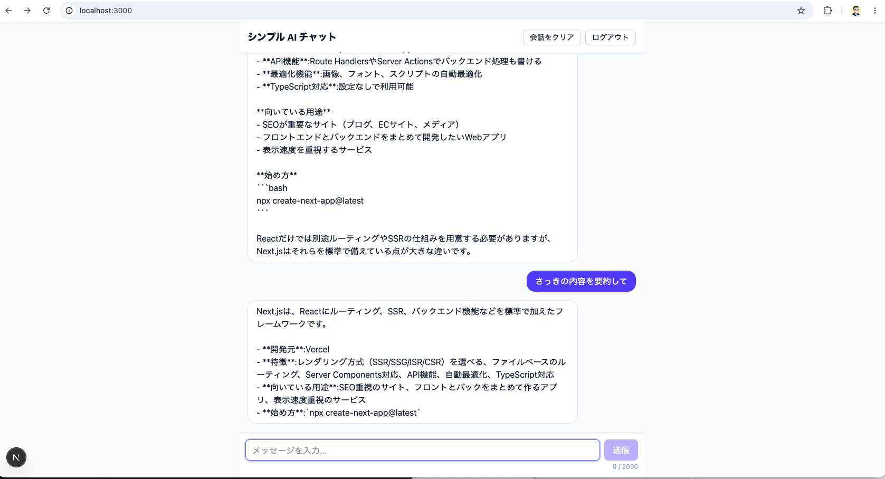
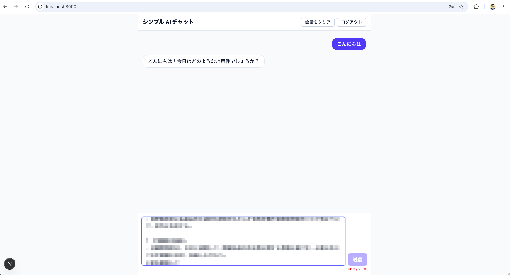
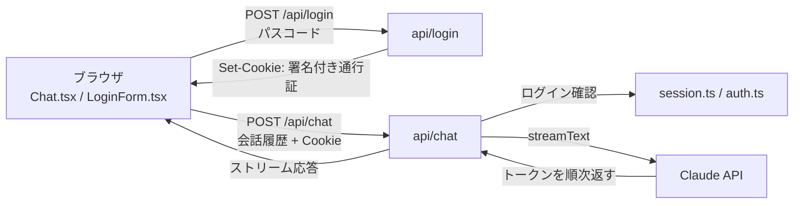

# シンプル AI チャット

Next.js・Vercel AI SDK・Claude API で作った、**パスコードログイン付きのストリーミングAIチャット**です。
「APIキーを差し込めば会話できる」最小構成(MVP)を、ログイン・入力制限・エラー処理まで含めて実務に近い形でまとめました。

## 📸 スクリーンショット

| ログイン | ストリーミング中 |
| --- | --- |
|  |  |

| 会話と要約 | 入力文字数の制限 |
| --- | --- |
|  |  |

## ✨ できること

| 機能 | 内容 |
| --- | --- |
| AIとの会話 | 入力した文章を Claude API に送り、返答を表示 |
| ストリーミング表示 | 返答を **1文字ずつ** 逐次描画（完成を待たずに読み始められる） |
| 会話履歴の保持 | 同じ画面を開いている間は文脈を保持（リロードでクリア） |
| キー操作 | **Enter で送信 / Shift+Enter で改行**（日本語変換中のEnterは送信しない） |
| パスコードログイン | パスコード1つで保護。未ログインではチャット画面もAPIも使えない |
| パスコードの表示切替 | 入力欄の「表示／隠す」ボタンで、入力内容を確認できる（既定は伏せ字） |
| 入力・出力の上限 | 入力2,000文字／履歴20件／出力1,024トークンで料金の暴走を防止 |
| エラー表示 | 認証失敗・混雑・サーバー障害を、利用者向けの日本語で表示。再試行ボタン付き |
| 操作ボタン | 生成の「停止」、「会話をクリア」、「ログアウト」 |

## 🧰 使用技術

| 分類 | 技術 | 役割 |
| --- | --- | --- |
| フレームワーク | Next.js 15 (App Router) | 画面とAPIを1つのプロジェクトで実装 |
| 言語 | TypeScript | 型による安全性 |
| AI連携 | Vercel AI SDK (`ai` / `@ai-sdk/react` / `@ai-sdk/anthropic`) | ストリーミングの取り回し、会話状態管理 |
| LLM | Claude API（既定: `claude-sonnet-5-5`） | 返答の生成 |
| スタイル | Tailwind CSS v4 | UIデザイン |
| 認証 | 自作（HMAC署名付きCookie / Node.js `crypto`） | 外部ライブラリ不要のパスコード認証 |
| テスト | Node.js 組み込み `node:test` | 認証ロジックの自動テスト |

## 🏗 アーキテクチャ



**APIキーはサーバー側（`api/chat`）だけが持ち、ブラウザには一切渡しません。**

## 🚀 セットアップ

必要なもの: Node.js 20.9 以上、[Anthropic の APIキー](https://console.anthropic.com/)

```bash
# 1. 依存パッケージをインストール
npm install

# 2. 環境変数ファイルを作成
cp .env.example .env.local
#    .env.local を開き、ANTHROPIC_API_KEY / APP_PASSCODE / SESSION_SECRET を設定

# 3. 開発サーバーを起動
npm run dev
```

ブラウザで <http://localhost:3000> を開くとログイン画面が表示されます。

### 環境変数（`.env.local`）

| 変数名 | 必須 | 説明 |
| --- | :---: | --- |
| `ANTHROPIC_API_KEY` | ✅ | Claude APIのキー |
| `APP_PASSCODE` | ✅ | ログイン用パスコード（1つ） |
| `SESSION_SECRET` | ✅ | Cookie署名用の秘密文字列（16文字以上） |
| `ANTHROPIC_MODEL` | | 使用モデル。省略時は `claude-sonnet-5-5` |

`.env.local` は `.gitignore` 済みです。**絶対にGitHubへ公開しないでください。**

### 使えるコマンド

| コマンド | 内容 |
| --- | --- |
| `npm run dev` | 開発サーバー起動 |
| `npm run build` / `npm start` | 本番ビルド／起動 |
| `npm run typecheck` | 型チェック |
| `npm test` | 認証ロジックの自動テスト |

## 📁 ディレクトリ構成

```
simple-ai-chat/
├── src/
│   ├── app/
│   │   ├── layout.tsx            # 全ページ共通の枠（<html>）
│   │   ├── page.tsx              # チャット画面（未ログインなら /login へ）
│   │   ├── login/page.tsx        # ログイン画面
│   │   └── api/
│   │       ├── chat/route.ts     # ★ Claude へ中継しストリーミング返却
│   │       ├── login/route.ts    # パスコード検証 → Cookie発行
│   │       └── logout/route.ts   # Cookie削除
│   ├── components/
│   │   ├── Chat.tsx              # ★ チャットUI（useChat）
│   │   └── LoginForm.tsx         # ログインフォーム
│   └── lib/
│       ├── config.ts             # システムプロンプト・各種上限値
│       ├── auth.ts               # トークン生成・検証（純粋ロジック）
│       └── session.ts            # Cookieからログイン判定
├── tests/auth.test.ts            # 認証の自動テスト
├── docs/learning-note.md         # 学習ノート（図解つき）
└── .env.example                  # 環境変数のひな形
```

## 🎯 達成基準と実装箇所

| 達成基準 | 実装 |
| --- | --- |
| Enter送信 / Shift+Enter改行 | `Chat.tsx` の `handleKeyDown` |
| 1文字単位のストリーミング | `api/chat/route.ts` の `smoothStream` ＋ `Chat.tsx` の `useChat` |
| セッション内の履歴保持 | `Chat.tsx` の `useChat`（`messages` ステート） |
| APIキーを `.env.local` で管理 | `.env.example` / `process.env.ANTHROPIC_API_KEY` |
| パスコードログイン | `auth.ts` / `api/login/route.ts` / `page.tsx` / `api/chat/route.ts` |

## 🧠 自分で設計した部分（AIに任せず判断したポイント）

| 項目 | 判断内容 | 場所 |
| --- | --- | --- |
| システムプロンプト | 結論ファースト・ユーザーの言語で回答・不明は「わかりません」と答える | `config.ts` |
| トークン上限管理 | 入力2,000字／履歴20件／出力1,024トークン。先頭が `assistant` にならないよう履歴を整形 | `config.ts` / `api/chat/route.ts` |
| エラーメッセージ | 内部エラーをそのまま見せず、原因別（認証／混雑／障害）の日本語に変換 | `api/chat/route.ts` の `toFriendlyMessage` |
| 日本語入力対応 | 変換確定のEnterで誤送信しない（`isComposing` / `keyCode 229`） | `Chat.tsx` |

## ✅ 検証結果

### 自動テスト（実施済み）

`npm test` で認証ロジック9項目をすべて確認しました（9 pass / 0 fail）。

- 正しい／誤ったパスコードの判定、`APP_PASSCODE` 未設定時の拒否
- 発行トークンの検証成功、**期限切れ・署名改ざん・期限だけの書き換え・別の秘密鍵で作られたトークンの拒否**

### 手動確認チェックリスト

動作環境: macOS / Node.js 22 / 実際の Claude API で確認

| # | 確認内容 | 期待する結果 | 結果 |
| --- | --- | --- | :---: |
| 1 | 未ログインで `/` を開く | `/login` に移動する | ✅ |
| 2 | 誤ったパスコードを入力 | 「パスコードが違います」と表示 | ✅ |
| 3 | 正しいパスコードを入力 | チャット画面に移動する | ✅ |
| 4 | メッセージを送信 | 返答が1文字ずつ表示される | ✅ |
| 5 | Enter キー | 送信される | ✅ |
| 6 | Shift+Enter | 改行される（送信されない） | ✅ |
| 7 | 日本語変換中にEnter | 送信されず、変換が確定するだけ | ✅ |
| 8 | 続けて質問（例:「さっきの内容を要約して」） | 前の会話を踏まえて答える | ✅ |
| 9 | ページをリロード | 履歴が消える（仕様） | ✅ |
| 10 | 生成中に「停止」 | 表示が止まる | ✅ |
| 11 | 2,001文字以上を入力 | 送信ボタンが無効になり、文字数が赤く表示 | ✅ |
| 12 | `ANTHROPIC_API_KEY` を誤った値にして送信 | 認証失敗の日本語メッセージが表示される | ✅ |
| 13 | 未ログインで `/api/chat` に curl で直接アクセス | 401 が返る | ✅ |

## 🔒 セキュリティ上の配慮と限界

**配慮していること**
- APIキー・パスコード・秘密鍵はサーバー側のみで使用（`NEXT_PUBLIC_` を付けていない）
- Cookie は `HttpOnly`・`SameSite=Lax`・本番では `Secure`
- パスコード比較は定時間比較、失敗時は0.8秒待機して総当たりを遅延
- チャットAPI側でも毎回ログインを確認（画面だけでなくAPIも保護）

**限界（本格運用で追加すべきこと）**
- 失敗回数によるロックアウト（IP単位のレート制限）は未実装
- 利用者単位の利用量制限・課金管理は未実装
- パスコードは全員共通のため、個人の識別・ログ追跡はできない

## 🔗 公開URL

- https://simple-ai-chat-six.vercel.app
（パスコードで保護されています。デモをご希望の方はご連絡ください）

## 🔭 今後の拡張アイデア

- Markdown / コードブロックの整形表示
- 会話履歴の永続化（DB・localStorage）
- レート制限（Upstash Redis 等）
- OpenAI など他モデルへの切り替え（`@ai-sdk/openai` に差し替えるだけで対応可能）

## 📚 学習ノート

実装を通して学んだことは [docs/learning-note.md](docs/learning-note.md) にまとめています。
