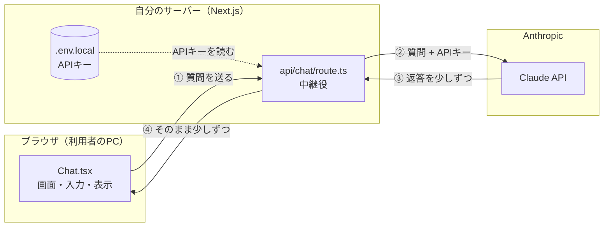
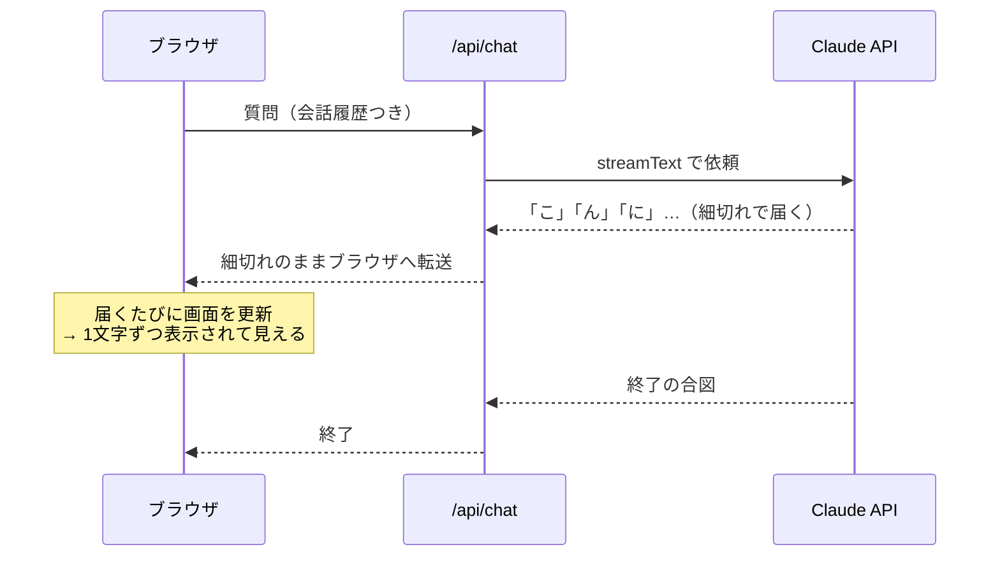
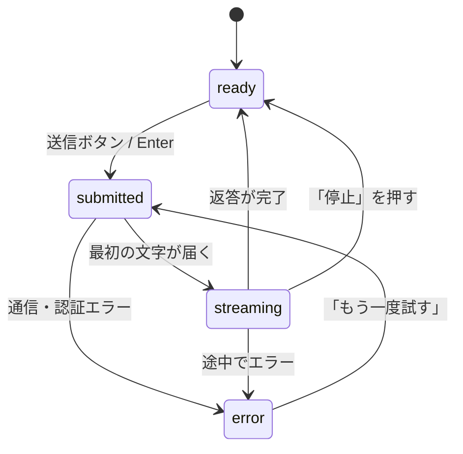
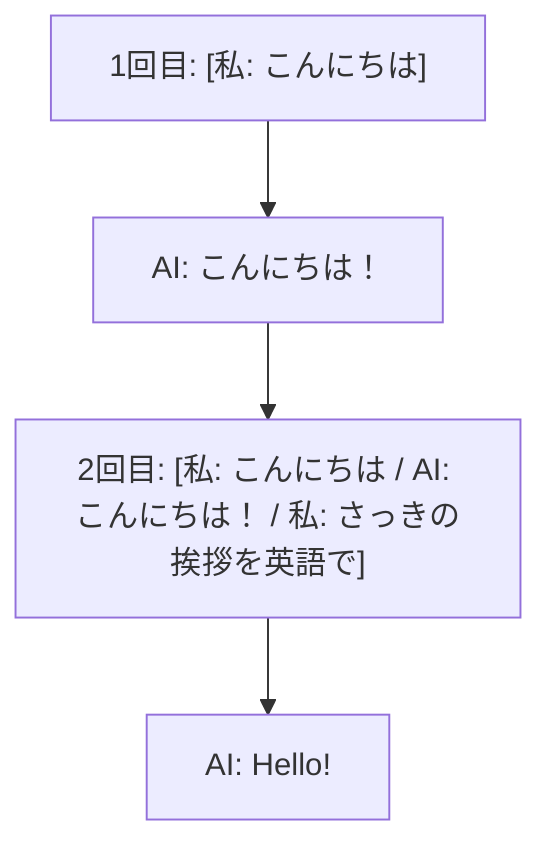
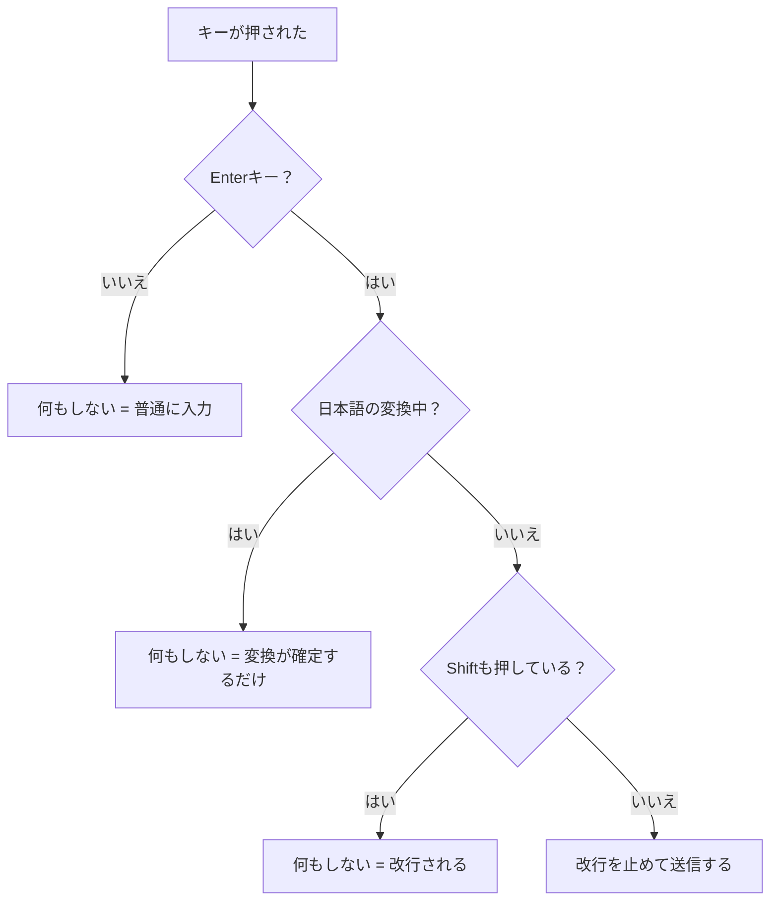
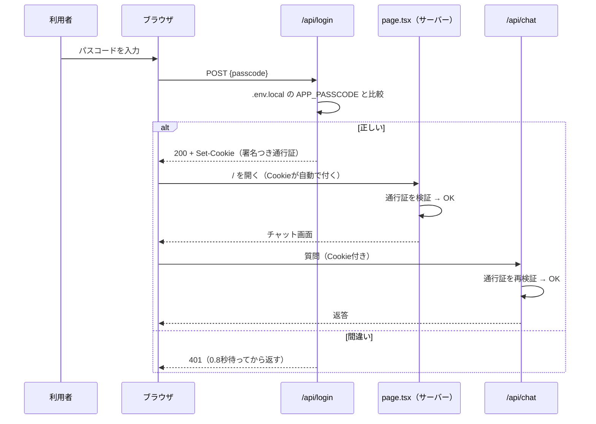
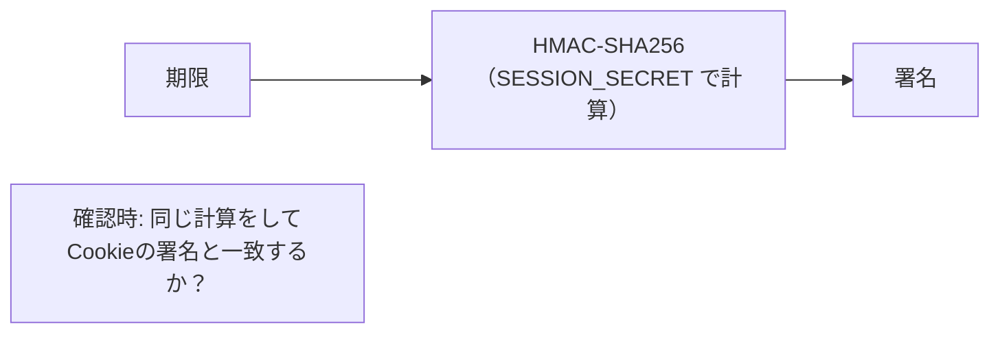
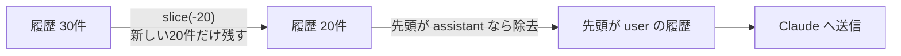
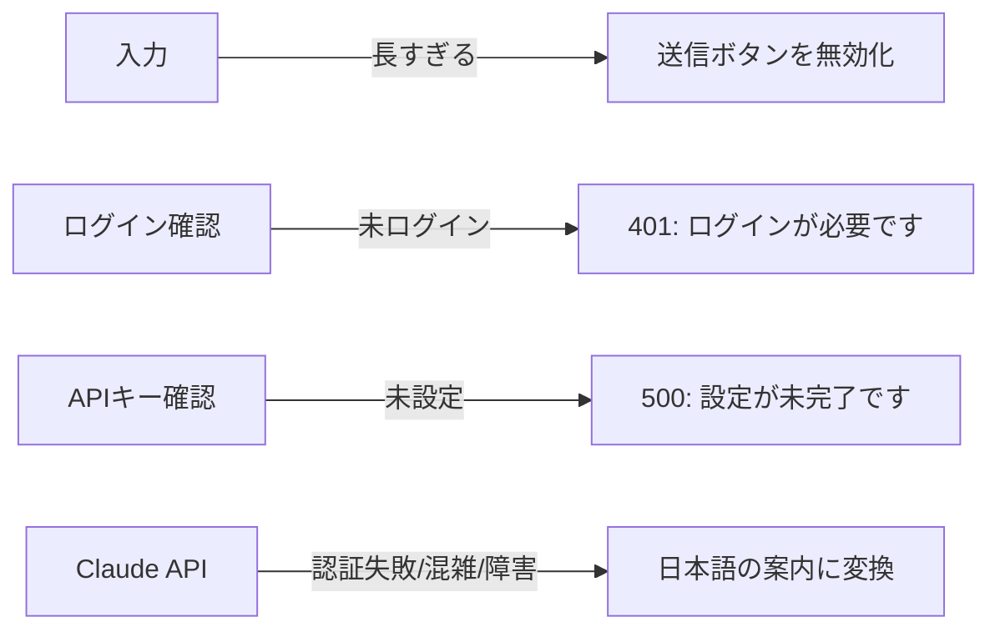

# 学習ノート：シンプル AI チャットを作って学んだこと

このノートは「AIチャットが動く仕組み」を、初心者の自分が後から読み返せるようにまとめたものです。
コードの場所は `ファイル名` で示しています。

## 目次

1. [全体像](#1-全体像)
2. [Next.js の基本：サーバーとブラウザの役割分担](#2-nextjs-の基本サーバーとブラウザの役割分担)
3. [環境変数と秘密情報の守り方](#3-環境変数と秘密情報の守り方)
4. [ストリーミングとは何か](#4-ストリーミングとは何か)
5. [Vercel AI SDK の使い方](#5-vercel-ai-sdk-の使い方)
6. [チャットUIの実装ポイント](#6-チャットuiの実装ポイント)
7. [パスコードログインの仕組み](#7-パスコードログインの仕組み)
8. [トークンと上限管理](#8-トークンと上限管理)
9. [エラー処理の考え方](#9-エラー処理の考え方)
10. [つまずきやすいポイント集](#10-つまずきやすいポイント集)
11. [用語集](#11-用語集)
12. [次に学ぶこと](#12-次に学ぶこと)
13. [追加機能](#13-追加機能)

---

## 1. 全体像

このアプリは「**ブラウザ**」「**自分のサーバー（Next.js）**」「**Claude API**」の3者でできています。



### なぜブラウザから直接 Claude を呼ばないの？

ブラウザのコードは **誰でも見られます**（開発者ツールで丸見え）。
そこにAPIキーを書くと盗まれ、他人に使われて**自分に請求が来ます**。
だから「サーバーが中継して、キーはサーバーだけが持つ」構成にします。

### 機能とコードの対応表

| やりたいこと | 担当ファイル | 主な関数・部品 |
| --- | --- | --- |
| 画面を表示 | `src/app/page.tsx` → `src/components/Chat.tsx` | `Chat` コンポーネント |
| 会話履歴を保持 | `Chat.tsx` | `useChat` の `messages` |
| Enter送信・Shift+Enter改行 | `Chat.tsx` | `handleKeyDown` |
| Claudeへ質問を中継 | `src/app/api/chat/route.ts` | `POST`、`streamText` |
| 1文字ずつ表示 | `route.ts` と `Chat.tsx` | `smoothStream`、`useChat` |
| システムプロンプト・上限値 | `src/lib/config.ts` | 各定数 |
| ログイン処理 | `src/app/api/login/route.ts` | `POST` |
| 通行証の作成・検証 | `src/lib/auth.ts` | `createSessionToken` / `verifySessionToken` |
| ログイン済みか判定 | `src/lib/session.ts` | `isLoggedIn` |
| 未ログインを追い返す | `src/app/page.tsx` | `redirect("/login")` |

---

## 2. Next.js の基本：サーバーとブラウザの役割分担

### 2-1. App Router とファイル配置

Next.js (App Router) では、**フォルダ構成がそのままURLになります**。

```
src/app/
├── page.tsx              →  http://localhost:3000/
├── login/page.tsx        →  http://localhost:3000/login
└── api/chat/route.ts     →  http://localhost:3000/api/chat   （画面ではなくAPI）
```

- `page.tsx` … 画面を作るファイル
- `route.ts` … 画面ではなく **API（データのやり取り窓口）** を作るファイル
- `layout.tsx` … 全ページ共通の枠

### 2-2. サーバーコンポーネントとクライアントコンポーネント

| | サーバーコンポーネント | クライアントコンポーネント |
| --- | --- | --- |
| 見分け方 | 何も書かない（既定） | ファイル先頭に `"use client"` |
| 動く場所 | サーバー | ブラウザ |
| 得意なこと | Cookieの確認、秘密情報の利用 | クリック・入力などの操作、`useState` |
| このアプリの例 | `page.tsx`, `login/page.tsx` | `Chat.tsx`, `LoginForm.tsx` |

`page.tsx` はサーバーで動くので、**ブラウザに画面を渡す前に**ログイン確認ができます。
未ログインなら `redirect("/login")` で、チャット画面のコードすら送られません。

```tsx
// src/app/page.tsx（抜粋）
if (!(await isLoggedIn())) {
  redirect("/login");
}
return <Chat />;
```

---

## 3. 環境変数と秘密情報の守り方

`.env.local` に書いた値は、サーバー側で `process.env.変数名` として読めます。

```
.env.local ──(起動時に読み込み)──▶ process.env.ANTHROPIC_API_KEY
```

| ルール | 理由 |
| --- | --- |
| `.env.local` を `.gitignore` に入れる | GitHubに公開するとキーが漏れる |
| 公開用の `.env.example`（値は空）を用意する | 他の人が何を設定すればよいか分かる |
| 変数名に `NEXT_PUBLIC_` を付けない | 付けると **ブラウザに公開される** |
| 変更後は開発サーバーを再起動 | 起動時にしか読み込まれない |

> 💡 万一キーを公開してしまったら、すぐにAnthropicのコンソールでキーを無効化（再発行）します。

---

## 4. ストリーミングとは何か

### 4-1. 従来方式との違い

| 方式 | 動き | 体感 |
| --- | --- | --- |
| 通常 | 返答がすべて完成してから一気に返す | 数秒〜十数秒、画面が止まって見える |
| ストリーミング | 出来上がった部分から順番に送る | すぐ文字が出始め、速く感じる |



### 4-2. 「1文字ずつ」にするための工夫

Claude から届く細切れ（トークン）は、数文字のかたまりのことがあります。
そこで `smoothStream` を使い、**1文字ずつ・一定間隔**に整えてから送っています。

```ts
// src/app/api/chat/route.ts（抜粋）
experimental_transform: smoothStream({ delayInMs: 15, chunking: /./su }),
```

- `delayInMs: 15` … 15ミリ秒ごとに出す（`config.ts` の `SMOOTH_DELAY_MS`）
- `chunking: /./su` … 「1文字にマッチする正規表現」。これで1文字単位に分割される

> 📝 `/./su` の `s` は改行にもマッチ、`u` は絵文字などの2バイト以上の文字を1文字として扱う指定です。

---

## 5. Vercel AI SDK の使い方

AI SDK は、ストリーミングや会話管理の面倒な部分を肩代わりしてくれるライブラリです。

### 5-1. サーバー側（`route.ts`）

```ts
const result = streamText({
  model: anthropic("claude-sonnet-5-5"),      // どのAIを使うか
  system: SYSTEM_PROMPT,                      // AIへの基本指示
  messages: await convertToModelMessages(messages), // 会話履歴を変換
  maxOutputTokens: 1024,                      // 出力の上限
});
return result.toUIMessageStreamResponse();    // ブラウザ向けのストリームにして返す
```

| 関数 | 役割 |
| --- | --- |
| `streamText` | Claudeに依頼し、返答をストリームで受け取る |
| `convertToModelMessages` | 画面用のメッセージ形式 → AI用の形式に変換 |
| `toUIMessageStreamResponse` | 結果をブラウザが読める形で返す |

### 5-2. ブラウザ側（`Chat.tsx`）

```ts
const { messages, sendMessage, status, error, stop, regenerate, setMessages } = useChat({
  transport: new DefaultChatTransport({ api: "/api/chat" }),
});
```

`useChat` 1つで、次のことを全部やってくれます。

| 受け取るもの | 中身 |
| --- | --- |
| `messages` | 会話履歴の配列（これを画面に表示する） |
| `sendMessage` | 送信する関数（履歴追加→API呼び出し→受信を一括で実行） |
| `status` | いまの状態（下の図） |
| `error` | エラー内容 |
| `stop` | 生成を途中で止める |
| `regenerate` | 最後の返答をやり直す |
| `setMessages` | 履歴を書き換える（クリア機能に使用） |

### 5-3. `status` の移り変わり



この `status` を使って、画面を切り替えています。

| status | 画面の動き |
| --- | --- |
| `submitted` | 「考え中…」を表示 |
| `streaming` | 送信ボタンが「停止」ボタンに変わる／二重送信を防止 |
| `ready` | 通常の入力状態 |

### 5-4. 会話履歴が「文脈」になる仕組み

AIは前の会話を覚えていません。**毎回、履歴を全部送り直す**ことで文脈を保っています。



そのため、会話が長くなるほど送るデータ（=料金）が増えます。→ [8章](#8-トークンと上限管理)

---

## 6. チャットUIの実装ポイント

### 6-1. Enter送信・Shift+Enter改行（`handleKeyDown`）



```ts
function handleKeyDown(e) {
  if (e.key !== "Enter") return;
  if (e.nativeEvent.isComposing || e.keyCode === 229) return; // 変換中は無視
  if (e.shiftKey) return;   // Shift+Enter は通常の改行
  e.preventDefault();       // Enterでの改行を止める
  submit();                 // 送信
}
```

### 6-2. ⚠️ 日本語入力の落とし穴

日本語を入力するとき、変換を確定する **Enter** も「Enterキー」として検知されます。
対策しないと、**変換を確定しただけで送信されてしまう**バグになります。

| 判定 | 意味 |
| --- | --- |
| `e.nativeEvent.isComposing` | 変換中なら `true`（多くのブラウザ） |
| `e.keyCode === 229` | Safari は確定の瞬間 `isComposing` が `false` になるため、この値で補う |

### 6-3. 自動スクロール

新しい文字が届くたび、画面の一番下にある目印 `<div ref={bottomRef} />` までスクロールします。

```ts
useEffect(() => {
  bottomRef.current?.scrollIntoView({ behavior: "smooth", block: "end" });
}, [messages, status]);   // messages か status が変わるたびに実行
```

### 6-4. メッセージの「parts」

1つのメッセージは、文章・画像・ツール結果などの **parts（部品）の配列**でできています。
今回は文章だけなので、`type === "text"` のものを取り出してつなげています。

```ts
const text = message.parts.map((p) => (p.type === "text" ? p.text : "")).join("");
```

---

## 7. パスコードログインの仕組み

### 7-1. 全体の流れ



### 7-2. 「通行証」の中身

```
1763000000.Xk3J9a...（長い文字列）
└─ 期限 ─┘ └─ 署名 ─┘
```

- **期限** … いつまで有効か（UNIX時間の秒）。ログインから7日後
- **署名** … `SESSION_SECRET` を使って期限から計算したハッシュ値（HMAC-SHA256）



**なぜ安全？** 期限を書き換える（例: 99999秒延ばす）と、計算し直した署名と一致しなくなります。
秘密の文字列を知らない人は、正しい署名を作れません。→ `tests/auth.test.ts` で確認済み。

### 7-3. Cookie の安全設定

| 設定 | 守ってくれるもの |
| --- | --- |
| `httpOnly: true` | ブラウザ上のJavaScriptからCookieを読めない（XSSで盗まれにくい） |
| `sameSite: "lax"` | 他のサイトからの勝手なリクエストにCookieを付けない（CSRF対策） |
| `secure: true`（本番） | HTTPS通信のときだけ送る |
| `maxAge` | 7日で自動的に失効 |

### 7-4. 守るべき場所は2か所

| 場所 | 理由 |
| --- | --- |
| `page.tsx`（画面） | 未ログインの人に画面を見せない |
| `api/chat/route.ts`（API） | **画面を経由せず直接APIを叩かれても**使わせない |

> 画面だけ守ってAPIを守らないのは「玄関に鍵をかけて窓を開けっ放し」と同じです。

### 7-5. 細かい工夫

- **定時間比較（`timingSafeEqual`）**: 比較にかかる時間の差から答えを推測される攻撃（タイミング攻撃）を防ぐ
- **先にハッシュ化してから比較**: 文字数の違いが漏れない
- **失敗時に0.8秒待つ**: 総当たりを遅くする

---

## 8. トークンと上限管理

### 8-1. トークンとは

AIが文章を処理する単位です。日本語は1文字がおおよそ1トークン前後になることが多く、**入力と出力の両方が料金の対象**です。

### 8-2. このアプリの3つの上限（`src/lib/config.ts`）

| 上限 | 値 | 守るもの |
| --- | --- | --- |
| `MAX_INPUT_CHARS` | 2,000文字 | 1回の入力が巨大になるのを防ぐ |
| `MAX_HISTORY_MESSAGES` | 20件 | 会話が長くなっても送信量が増え続けない |
| `MAX_OUTPUT_TOKENS` | 1,024トークン | 1回の返答が長すぎるのを防ぐ |



**先頭を user にする理由**: Claude は「最初の発言はユーザー」という決まりがあります。
履歴を切ると先頭がAIの発言になることがあり、そのままだとエラーになるため取り除いています。

### 8-3. システムプロンプトの設計

AIの性格やルールを決める「基本指示」です（`config.ts` の `SYSTEM_PROMPT`）。

| 指示 | 狙い |
| --- | --- |
| ユーザーの言語で答える | 日本語で聞けば日本語で返る |
| 結論から述べる | 読みやすさ |
| わからないことは「わかりません」と言う | もっともらしい嘘（ハルシネーション）を減らす |

---

## 9. エラー処理の考え方

### 9-1. エラーが起きうる場所



### 9-2. 内部エラーをそのまま見せない

詳細なエラーには、内部情報が含まれることがあります。
そのため、**詳しい内容はサーバーのログ（`console.error`）に残し、利用者には分かりやすい文だけ**を見せます。

| 状況 | 利用者への表示 |
| --- | --- |
| 401 / 403 | AIサービスの認証に失敗しました。APIキーを確認してください。 |
| 429 | リクエストが多すぎます。しばらく待ってからもう一度お試しください。 |
| 5xx | AIサービス側で一時的な問題が起きています。時間をおいて再度お試しください。 |
| その他 | エラーが発生しました。もう一度お試しください。 |

エラー時は「もう一度試す」ボタン（`regenerate`）を出し、利用者が次の行動を取れるようにしています。

---

## 10. つまずきやすいポイント集

| 症状 | 原因と対処 |
| --- | --- |
| `.env.local` を直したのに反映されない | 開発サーバー（`npm run dev`）を再起動する |
| 「APIキーが設定されていません」 | ファイル名が `.env.local` か、変数名が `ANTHROPIC_API_KEY` か確認 |
| ログインしてもすぐ戻される | `SESSION_SECRET` が16文字未満・未設定ではないか確認 |
| 日本語変換のEnterで送信される | `isComposing` の判定が抜けている |
| 返答が途中で切れる | `MAX_OUTPUT_TOKENS` に達している。値を上げる |
| `cookies()` でエラー | Next.js 15以降は `await cookies()` が必要 |
| 「`"use client"` が必要」エラー | `useState` や `onClick` を使うファイルの先頭に追加 |
| 型エラーが出る | AI SDKはバージョンで書き方が変わる。`package.json` のバージョンと公式ドキュメントの版を合わせる |

---

## 11. 用語集

| 用語 | 意味 |
| --- | --- |
| LLM | 大規模言語モデル。Claudeのような文章生成AI |
| API | プログラム同士がやり取りするための窓口 |
| APIキー | APIを使うための合言葉（＝課金の鍵） |
| ストリーミング | データを完成を待たず、できた分から順に送る方式 |
| トークン | AIが文章を処理する単位 |
| システムプロンプト | AIへの基本指示（性格・ルール） |
| Cookie | ブラウザに保存される小さなデータ。ログイン状態の保持に使う |
| HMAC | 秘密鍵を使ったハッシュ。改ざん検知に使う |
| 環境変数 | コードの外に置く設定値（秘密情報など） |
| ハルシネーション | AIがもっともらしい嘘を答えること |
| IME | 日本語入力システム。変換中の状態を持つ |

---

## 12. 次に学ぶこと

1. **Markdown表示**: AIの返答に含まれる見出し・リスト・コードを整形して表示する（`react-markdown`）
2. **履歴の永続化**: `localStorage` やデータベースに保存して、リロードしても残す
3. **レート制限**: 一定時間内のアクセス回数を制限する（Upstash Redis など）
4. **ツール呼び出し（Tool Calling）**: AIに天気取得や計算などの関数を使わせる
5. **デプロイ**: Vercel に公開し、環境変数をダッシュボードで設定する
6. **モデルの切り替え**: `@ai-sdk/openai` に差し替えて、同じ構成でOpenAIを使ってみる

---

## 13. 追加機能：パスコードの表示／非表示ボタン

講師のフィードバックを受けて、ログイン画面に「表示／隠す」ボタンを追加しました。

### 仕組み

`useState` で「表示中か」を覚え、入力欄の `type` を切り替えるだけです。

```tsx
const [showPassword, setShowPassword] = useState(false);

<input type={showPassword ? "text" : "password"} ... />
<button type="button" onClick={() => setShowPassword((prev) => !prev)}>
  {showPassword ? "隠す" : "表示"}
</button>
```

### 学んだこと

| ポイント | 内容 |
| --- | --- |
| 状態で見た目を切り替える | `true` / `false` の状態を 1 つ持つだけで、表示を切り替えられる |
| `type="button"` が必要 | フォーム内のボタンは、既定で送信ボタンになる。付け忘れると、押した瞬間にログイン処理が走る |
| 位置の重ね方 | 親に `relative`、ボタンに `absolute` を付けて、入力欄の右端に重ねる |
| 余白の確保 | 入力欄に `pr-16`（右の余白）を付けて、文字がボタンに隠れないようにする |
| アクセシビリティ | `aria-label` と `aria-pressed` で、読み上げソフトにも状態が伝わる |
| 安全面 | 画面を人に見られる場所でも安全なように、既定は「隠す」にしてある |